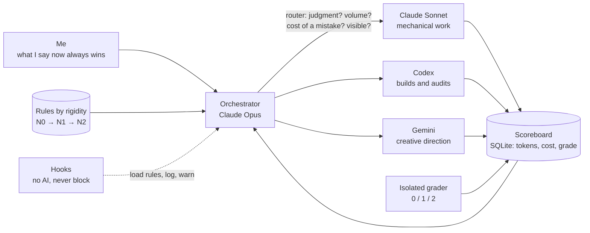

# Humanify

**The layer I use every day to work with several AI models at once.** It sits on top of Claude Code and coordinates Claude (Opus and Sonnet), OpenAI Codex and Google Gemini across all my projects, so the same correction never has to be learned twice and delegated work leaves a record of what it cost and how well it went.



## The problem

When you work with several models across many projects, two things go wrong. Each chat starts from zero, so you correct the same mistakes again and again. And you choose which model does what by gut feeling, without knowing what anything actually cost or how often it had to be redone.

## How it works

- **Rules by rigidity.** `N0` is a short constitution only I can change. `N1` rules need evidence: each one carries its scope, evidence (`ev: x3`, dates, source), a counter-example field and a confirmation date. `N2` are references and preferences. `N3` is what I say in the moment, which always wins and is never stored. → [docs/brain/](docs/brain/)
- **A model router with four questions.** How much judgment does it need? How much volume? How expensive is a mistake? Would the mistake be visible, or would it come out convincing and hidden? → [model router](docs/brain/model-router.md)
- **Hooks written without AI.** One dispatcher (`hooks/humanify.sh`) is registered on six Claude Code events: session start, compaction, each message, file edits, subagent launch and finish, and session end. It loads the right rules, suggests the right contract by keyword, logs delegations and closes each session. It never blocks: a 5-second timeout (10 s at session end), fail open, log the error. See [instalacion/settings.example.json](instalacion/settings.example.json).
- **The scoreboard.** Subagent, Codex and Gemini runs are recorded in SQLite: tokens, estimated cost (when the provider reports usage), duration, role. An isolated grader model scores tasks 0/1/2 against a written contract, or marks them not evaluable when the evidence is thin. → [scoreboard and rooms](docs/scoreboard-and-rooms.md)
- **Rooms.** When several agents work on the same problem, they share one brief and leave findings in one file, and the useful parts are rescued when the room closes.

## Where judgment sits

- **Never switch models on fewer than five cases.** Numbers from one or two runs feel convincing and mean little; the rule is written into the router.
- **One in five routine tasks suggests trying a cheaper model**, so the system keeps learning; the orchestrator decides, and never on tasks where a mistake is expensive.
- **Detect, don't armor.** The agents cooperate; the risk is that they drift. So nothing blocks them: the hooks watch, log and warn.
- **Numbers go to SQLite; judgment, rules and explanations go to Markdown**, where a person can read and edit them.
- **Creative ideas are grounded before they're built.** A model's design once proposed something that couldn't be programmed and had to be redone; now every creative proposal is checked against the real limits first.

## What I decided, what the models did, what a person verified

| | |
|---|---|
| **I decided** | The levels, the router's four questions, the five-case rule, what gets measured, and every N1 rule (they need my yes). |
| **The models did** | Claude designed and wrote briefs; Codex built from those briefs (eleven rounds, each with a 10-line report) and ran adversarial reviews (three reviewers in parallel and a fourth verifier, which found four gaps the first three missed). → [docs/process/](docs/process/) |
| **A person verified** | The design reviews, every rule promoted to N1, and the routing decisions taken from the numbers. |

The first version (databases, a Next.js app, "memory cells") was archived as pretty but impractical. This version is plain Markdown plus small scripts.

## Numbers

From a single read-only snapshot of my own scoreboard (Nov 2–13, 2026): **425 tasks, 1,113 agent runs, 414 grades**, and about **US$217** in estimated API-equivalent cost for the Claude runs (Codex and Gemini run on subscriptions and have no USD figure). Most comparisons between models are 1 to 3 cases: operating numbers, not statistical conclusions. → [docs/numbers.md](docs/numbers.md)

## Install

1. Clone this repository and set `HUMANIFY_HOME` to its path.
2. Add one line to `~/.claude/CLAUDE.md`: `@<path-to-repo>/cerebro/CONSTITUCION.md` (write the real path; Claude Code does not expand variables there). Deleting that line turns Humanify off.
3. Merge the hook entries from [instalacion/settings.example.json](instalacion/settings.example.json) into `~/.claude/settings.json`, replacing `$HUMANIFY_HOME` with the real path.
4. Optional: copy the skills in `instalacion/skills/` to `~/.claude/skills/`, and call Codex and Gemini through `herramientas/codex.sh` / `herramientas/argon.sh` so their runs are recorded.

## Run the tests

Python 3.9+, standard library only.

```bash
python3 -m unittest discover -s tests -v     # 270 tests (1 skipped without ffmpeg)
python3 examples/make_scoreboard_sample.py   # rebuilds the synthetic scoreboard in examples/
```

## Repository

```
cerebro/      the rules the system loads (Spanish, as used): constitution, rules, model router, keyword router, contracts
hooks/        Claude Code hooks and their Python logic (dispatcher, scoreboard, grader, rooms, routes)
herramientas/ command-line tools: status, scoreboard, Codex and Gemini wrappers that record their own runs
equipo/       the cast: each agent's role and character, and stage routes
plantilla/    template to start a new project with this structure
instalacion/  hook settings example, skills, room templates, a macOS launcher
docs/         English: architecture, scoreboard, translated rules, process examples, numbers
tests/        unit tests with fake agents
examples/     synthetic scoreboard database
```

## Notes

- The rule files and code identifiers are in Spanish because the system reads them as they are. Translations are in [docs/brain/](docs/brain/).
- Some rules mention contracts for design, video and writing that are specific to my projects and not included here.
- Not to be confused with *Humanify*, the enterprise AI workspace prototype I led with a team of five at UC Berkeley in summer 2026. This repository is my personal working system; it kept the name.
- The video production line that runs on this layer is its own repository: [ai-video-factory](https://github.com/didierguisland/ai-video-factory).

## License

[MIT](LICENSE)
